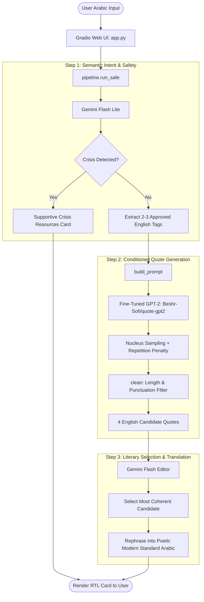

# 🌿 Arabic Quote Generator (مولّد الاقتباسات)

An intelligent, multi-stage hybrid AI system that turns user thoughts, feelings, and expressions in Arabic into eloquent, culturally resonant Modern Standard Arabic quotes.

The project blends a specialized **fine-tuned GPT-2 model** (for creative, theme-conditioned quote generation) with **Google Gemini models** (for semantic intent extraction, crisis safety checks, and high-literary Arabic rephrasing).

---

## 📌 Table of Contents
- [✨ Key Features](#-key-features)
- [🏗️ System Architecture & Workflow](#️-system-architecture--workflow)
- [📖 Real-World Walkthrough: The "صبر" (Patience) Example](#-real-world-walkthrough-the-صبر-patience-example)
- [📊 Dataset & Data Version Control (DVC)](#-dataset--data-version-control-dvc)
- [📂 Project Structure](#-project-structure)
- [🚀 Quick Start & Installation](#-quick-start--installation)
- [🐳 Running with Docker](#-running-with-docker)
- [🧠 Model Training & Fine-Tuning](#-model-training--fine-tuning)
- [🛡️ Safety & Crisis Intervention](#️-safety--crisis-intervention)

---

## ✨ Key Features

* **Hybrid AI Architecture**: Combines local causal language modeling (GPT-2) with state-of-the-art LLMs (Gemini Flash & Gemini Flash Lite).
* **Culturally Nuanced Arabic Quotes**: Produces quotes with natural rhythm, balance, and literary depth rather than mechanical word-for-word translation.
* **Controlled Theme Conditioning**: Aligns Arabic user sentiments with a curated vocabulary of over 100+ vetted themes.
* **Responsible Safety Filter**: Proactively detects distress or self-harm keywords, providing supportive crisis resources instead of generated text.
* **Reproducible Data Pipeline**: Managed via [DVC (Data Version Control)](https://dvc.org/) and automated Parquet data pipelines.
* **Modern Web Interface**: Built with Gradio, featuring responsive Right-to-Left (RTL) styled presentation cards.

---

## 🏗️ System Architecture & Workflow

The generation pipeline operates in three distinct, coordinated stages:



1. **Step 1 — Semantic Theme Extraction & Safety Check**:
   * Uses `Gemini Flash Lite` with structured Pydantic schema validation.
   * Analyzes the Arabic statement to map the user's emotional or philosophical intent to 2–3 tags from a predefined vocabulary (e.g., `['courage', 'hope', 'wisdom']`).
   * Simultaneously evaluates whether the user is expressing distress or thoughts of self-harm.

2. **Step 2 — Creative Generation via Fine-Tuned GPT-2**:
   * Formats the extracted themes into a strict prompt: `Themes: <tag1>, <tag2>\nQuote:`.
   * The custom fine-tuned GPT-2 model generates diverse candidate quotes using temperature sampling ($T=0.75$), top-$p$ nucleus sampling ($0.90$), and repetition penalties.
   * Post-filters candidates to ensure complete sentences, appropriate length (5–45 words), and grammatical integrity.

3. **Step 3 — Selection & Eloquent Arabic Synthesis**:
   * A stronger model (`Gemini Flash`) reviews the candidates alongside the original Arabic statement.
   * It selects the most coherent and fitting candidate, then renders it into authentic Modern Standard Arabic (*الفصحى*) with rhetorical balance, avoiding literal translation artifacts.

---

## 📖 Real-World Walkthrough: The "صبر" (Patience) Example

To understand how each module cooperates, consider a user seeking inspiration during hardship around the concept of **الصبر (Patience / Perseverance)**:

### 1. User Input (Gradio UI)
> **المستخدم:** «أمرّ بوقت صعب ومليء بالتحديات، وأحتاج إلى الصبر والعزيمة لأتجاوز هذه المرحلة.»  
> *(English translation: "I am going through a difficult time full of challenges, and I need patience and resolve to overcome this phase.")*

### 2. Semantic Extraction & Tag Mapping (`pipeline.py`)
The extraction model identifies the emotional sentiment, confirms no crisis markers exist, and matches the input to vocabulary tags:
```json
{
  "themes": ["courage", "hope", "strength"],
  "in_crisis": false
}
```

### 3. Conditioned Local Generation (`generate.py`)
Conditioned on `Themes: courage, hope, strength\nQuote:`, the fine-tuned GPT-2 model samples 4 distinct candidate quotes:
```text
Candidate 0: Patience is the quiet strength that turns endurance into triumph.
Candidate 1: Hope is being able to see that there is light despite all the darkness.
Candidate 2: Strength does not come from what you can do, but from overcoming what you once thought you could not.
Candidate 3: In the darkest hours, courage is the silent voice that whispers to try again.
```

### 4. Selection & Arabic Crafting (`pipeline.py`)
The editor agent selects **Candidate 0** as the most fitting and crafts a balanced, rhythmic Arabic quote:
> **الاقتباس المختار باللغة الإنجليزية:**  
> *"Patience is the quiet strength that turns endurance into triumph."*
>
> **الصياغة العربية الفصيحة:**  
> **«الصبر ليس مجرد صمتٍ في وجه العاصفة، بل هو القوة الهادئة التي تصنع من الصمود فجرًا للظفر.»**

### 5. Frontend Presentation (`app.py`)
Displayed on a clean, centered Arabic card:
```html
<div style="direction:rtl; text-align:center; font-size:30px; line-height:1.9; padding:24px;">
  «الصبر ليس مجرد صمتٍ في وجه العاصفة، بل هو القوة الهادئة التي تصنع من الصمود فجرًا للظفر.»
</div>
```

---

## 📊 Dataset & Data Version Control (DVC)

### Data Source
The training dataset is sourced from the [Quotes Dataset on Kaggle by Maruf Chowdhury](https://www.kaggle.com/datasets/marufchowdhury/quote-dataset), which contains approximately 500,000 international quotes complete with tags, categories, and author attributions.

### Why DVC (Data Version Control)?
Raw machine learning datasets and compiled Parquet splits are too large to be stored directly in Git repositories. To solve this, **DVC** is used to:
* **Track Dataset Versions**: Hash and version raw files (`Quote_data.csv`) and processed splits (`train.parquet`, `validation.parquet`, `test.parquet`).
* **Ensure Pipeline Reproducibility**: Guarantee that experiments, token distributions, and vocabulary sets are deterministic across environments.
* **Keep Git Repositories Lightweight**: Store metadata pointers (`.dvc` files) in Git while managing actual binary data files separately.

```bash
# Pull version-controlled data files tracked by DVC
dvc pull
```

### Data Preprocessing Highlights ([`src/data/normalize.py`](file:///home/beshr/Personal/Plans/first%20month/Arabic%20Quote%20Generator/src/data/normalize.py))
* **ASCII & English Filtering**: Retains only clean ASCII text and applies stopword frequency heuristics (`looks_english`).
* **Tag Lemmatization**: Uses WordNet Lemmatizer to consolidate tags (e.g., `"loves"` $\rightarrow$ `"love"`).
* **Length Constraints**: Enforces word limits between 4 and 60 words per quote.
* **Dataset Splits**: 80% Train, 10% Validation, 10% Test saved in optimized Apache Parquet format.

---

## 📂 Project Structure

```text
Arabic-Quote-Generator/
├── data/
│   └── assets/
│       └── vocab.json            # Curated vocabulary of allowed theme tags
├── data_en/                      # Managed via DVC
│   ├── raw/                      # Raw Kaggle Quote_data.csv
│   └── processed/                # train.parquet, validation.parquet, test.parquet
├── models/                       # Local model checkpoints
│   └── gpt2-en/final_model/      # Fine-tuned weights & tokenizer
├── src/
│   ├── data/
│   │   ├── assets.py             # Script to extract and dump vocab.json
│   │   ├── build_dataset.py      # End-to-end data cleaning, filtering & splitting
│   │   └── normalize.py          # Regex cleaners, lemmatizers & English heuristics
│   ├── modeling/
│   │   ├── generate.py           # Cached inference engine & top-p generator
│   │   ├── pipeline.py           # Multi-stage Gemini + GPT-2 orchestrator
│   │   ├── train.py              # Hugging Face Trainer pipeline with masked causal loss
│   │   └── upload_model.py       # Utility to push model checkpoints to Hugging Face
│   └── frontend/
│       └── app.py                # Gradio web application with RTL card styling
├── .dvc/                         # DVC configuration and cache
├── .env.example                  # Environment template for API keys
├── docker-compose.yml            # Multi-platform container configuration
├── Dockerfile                    # Container definition
├── requirements.txt              # Production Python dependencies
└── README.md                     # Project documentation
```

---

## 🚀 Quick Start & Installation

### Prerequisites
* Python 3.10+ (Python 3.12 recommended)
* A Google Gemini API key ([Google AI Studio](https://aistudio.google.com/))

### 1. Clone & Set Up Virtual Environment
```bash
git clone https://github.com/Beshr-Sofi/Arabic-Quote-Generator.git
cd "Arabic-Quote-Generator"

python3 -m venv env
source env/bin/activate
```

### 2. Install Dependencies
```bash
pip install -r requirements.txt
```

### 3. Configure Environment Variables
Copy `.env.example` to `.env` and insert your Gemini API Key:
```bash
cp .env.example .env
```
Inside `.env`:
```env
GOOGLE_API_KEY="your-google-gemini-api-key-here"
```

### 4. Launch the Web Application
```bash
python -m src.frontend.app
```
Open your browser at `http://localhost:7860`.

---

## 🐳 Running with Docker

You can run the application in an isolated environment using Docker and Docker Compose:

```bash
# Build and run with docker-compose
docker compose up --build
```

The container automatically connects to Hugging Face Hub to pull the fine-tuned model ([`Beshr-Sofi/quote-gpt2`](https://huggingface.co/Beshr-Sofi/quote-gpt2)) and mounts a cache volume to prevent redownloading weights on container restarts.

---

## 🧠 Model Training & Fine-Tuning

The quote generator uses a causal GPT-2 architecture fine-tuned specifically for conditioning on theme tags.

### Key Training Highlights ([`src/modeling/train.py`](file:///home/beshr/Personal/Plans/first%20month/Arabic%20Quote%20Generator/src/modeling/train.py)):
* **Prompt-Completion Causal Masking**: The prompt `Themes: ...\nQuote:` is masked with token ID `-100` so that cross-entropy loss is computed exclusively on the generated quote tokens.
* **Hyperparameters**:
  * Learning rate: `2e-5` with AdamW and linear warmup
  * Early stopping patience: 3 epochs
  * Evaluation metric: Best validation loss (`eval_loss`)
  * Dynamic padding via `DataCollatorForSeq2Seq`
* **Pretrained Weights**: Available on Hugging Face at [`Beshr-Sofi/quote-gpt2`](https://huggingface.co/Beshr-Sofi/quote-gpt2).

To rerun preprocessing and training locally:
```bash
# 1. Clean and split dataset
python -m src.data.build_dataset

# 2. Fine-tune GPT-2
python -m src.modeling.train
```

---

## 🛡️ Safety & Crisis Intervention

This application incorporates compassionate safety protocols. If a user inputs text indicating emotional crisis, self-harm, or suicidal ideation:
* The system bypasses quote generation entirely.
* It returns an immediate supportive message in Arabic directing the user to professional help and emergency services:

> *«يبدو أنك تمرّ بوقت صعب جدًا، وهذا يستحق أن تتحدث عنه مع شخص تثق به أو مع مختص. وإذا كنت في خطر فوري فتواصل مع خدمات الطوارئ في بلدك.»*

---

## 📄 License
This project is open-source under the MIT License.
